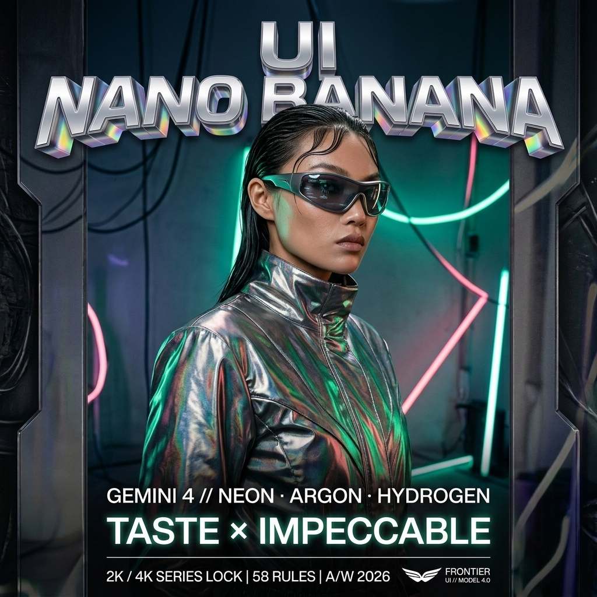

# ui-nanobanana — Taste + Impeccable + Nano Banana (Edición OP 2K/4K)

*Lee esto en otros idiomas: [English](README.md), [Español](README.es.md).*

[](LICENSE)
[](https://github.com/AntonioCardenas/ui-nanobanana/stargazers)
[](https://github.com/AntonioCardenas/ui-nanobanana/commits/main)
[](https://github.com/vercel-labs/skills)

> La habilidad definitiva de dirección de arte UI y frontend anti-slop para agentes de IA (**Antigravity**, **Antigravity CLI**, **Claude Code**, **Cursor**, **Codex**). Combina la dirección de arte probada en galerías de **Taste Skill** y los rieles deterministas `DESIGN.md` + 58 reglas anti-patrones de **Impeccable** con un **pipeline visual OP de alta resolución (2K/4K)** impulsado por **Nano Banana 2.1**, **Nano Banana Pro**, **Gemini Omni 1.2 Flash** y la familia **Gemini 4** (**Gemini 4 Carbon**, **Gemini 4 Argon**, **Gemini 4 Neon**, **Gemini 4 Hydrogen**).

[](ui_nanobanana_showcase.png)
*Portada oficial generada con Nano Banana Pro y Gemini 4 Neon: retrato editorial Y2K Solarpunk-Cyber (estudio nocturno `#0c1624`, reflejos de neón verde clorofila `#38d399` y rosa coral `#f472b6`, `GEMINI 4 // NEON · ARGON · HYDROGEN`, `TASTE × IMPECCABLE`).*

---

## Por Qué Existe Esta Habilidad

Los agentes de código generativo fallan en diseño frontend de dos formas predecibles:

1. **Slop estructural y de CSS:** Si se les deja a su libre albedrío, producen el promedio estadístico de cada plantilla: titulares centrados de tres líneas, etiquetas *eyebrow* en mayúsculas (`"NEW · BETA"`), fuente `Inter` sobre degradados morado-azul (o el cliché editorial crema y terracota), filas de tres tarjetas con iconos y numeración `01 / 02 / 03`.
2. **El vacío de sustancia visual:** Incluso cuando eliminas los degradados y las tarjetas anidadas mediante reglas CSS, una página sin imágenes reales —o con fotos de stock inconexas— se siente vacía. El estudio empírico de 247 sitios de galería y 91 *Sites of the Day* de Awwwards demuestra que **las páginas mejor valoradas incluyen entre 6 y 12 recursos visuales cohesivos**, cubren al menos la mitad de la primera pantalla con media principal en el 68% de los casos ganadores y combinan geometría tipográfica estricta con demostraciones interactivas reales.

`ui-nanobanana` resuelve ambas mitades en un único flujo determinista:

- **Rieles Deterministas tipo Impeccable (`DESIGN.md` + `PRODUCT.md` + 58 Reglas):** Compila tu paleta de marca, escala tipográfica de 5 pasos, modo de superficie (`Persuade`, `Operate`, `Read`, `Experience`) y `anti_references` explícitas (p. ej., estética Solarpunk minimalista sobre base oscura `#0c1624`, prohibición del blanco puro `#ffffff`, cero manos o armas en recursos visuales) en archivos deterministas que cada comando respeta.
- **Motor de Dirección de Arte tipo Taste Skill:** Impone un **Inventario del Sujeto** (8–12 detalles exclusivos del cliente), la **Prueba del Competidor**, **One Live Thing** (un micro-instrumento interactivo real en la página), **Aritmética de Titulares de Dos Líneas** ($\le 32$ caracteres para `h1` en `1440px`, `768px` y `390px`) y **Variedad Combinatoria de Composición** (sin caer por defecto en el hero texto-izquierda / imagen-derecha ni repetir layouts en secciones vecinas).
- **Pipeline Visual OP en Alta Resolución con Nano Banana:** Sincroniza automáticamente `DESIGN.md` con `generations/refs/brand/style.md`, presenta **un único Plan de Medios por Lote y Cotización** al inicio, genera primero la **placa Hero en 2K/4K** con zonas seguras de espacio negativo para superposición tipográfica, y bloquea todas las imágenes de sección subsiguientes (**Series Lock**), bucles de video mudos en **Gemini Omni 1.2 Flash** (`3s`–`15s`) y código visual SVG/Three.js/Shaders con **Gemini 4 Argon / Neon / Hydrogen** a la iluminación y gradación de color exactas del Hero.

---

## Instalación

Instala directamente desde este repositorio usando el [CLI de `skills`](https://github.com/vercel-labs/skills):

```bash
npx skills add AntonioCardenas/ui-nanobanana
export GEMINI_API_KEY=tu_clave_aqui
```

O clona directamente en el directorio de habilidades de tu agente (nombrar la carpeta `ui` registra el comando `/ui`):

```bash
git clone https://github.com/AntonioCardenas/ui-nanobanana ~/.claude/skills/ui
```

---

## El Flujo Maestro de 10 Pasos (`/ui craft`)

1. **Contexto, Stack e Inventario del Sujeto** — Lee `DESIGN.md` / `PRODUCT.md`, respeta tu arquitectura (Angular v22 Zoneless + Signals, React/Next.js, Astro, GSAP, Lenis, Tailwind) e inventaría 8–12 hechos únicos del proyecto.
2. **Argumento y Aritmética de Copy de Dos Líneas** — Estructura las secciones como **Afirmación $\rightarrow$ Prueba** y garantiza $\le 2$ líneas por titular en todo viewport ($\le 32$ caracteres para `h1`).
3. **Dirección de Arte y Matriz de Composición** — Fija el Paradigma de Tema, la Escala del Hero (`Giant Statement`, `Mid Editorial`, `Mini Minimalist`) y anclas de composición variadas por sección.
4. **La Idea, Prueba del Competidor y "One Live Thing"** — Define la Oración de la Idea y diseña un elemento interactivo funcional que demuestre el valor con datos reales.
5. **Plan de Medios por Lote y Única Puerta de Aprobación de Costo** — Cotiza toda la suite visual 2K/4K (Hero + Placas de Sección + Divisores Panorámicos + bucle de video Omni + SVGs/Shaders en Argon) en una sola tabla y espera tu confirmación.
6. **Generación Secuencial de Alta Resolución con Series Lock** — Antepone `style.md` literalmente, genera el Hero 2K/4K primero, pasa el Hero en `reference_images` (o `previous_interaction_id`) para el resto de secciones y guarda los sidecars `.json`.
7. **Construcción Estática y Arquitectura de Tokens** — Define custom properties de CSS, márgenes exteriores iguales, marcado ``/`<video>` con cero CLS y velos tonales (`scrims`), y tematiza superficies del navegador (`::selection`, `:focus-visible`, `tabular-nums`).
8. **Capa de Movimiento con Propósito** — Añade 1 movimiento de autor, entradas escalonadas, feedback táctil y soporte para `prefers-reduced-motion`.
9. **Auditoría Determinista de 58 Reglas y Verificación Multi-Viewport** — Verifica `0 FAIL` en las 58 reglas anti-slop a `1440px`, `768px` y `390px`.
10. **Pulido e Informe de Entrega** — Entrega la puntuación final de auditoría, el resumen de la Idea y el Manifiesto de Medios en Alta Resolución.

---

## Vocabulario de Sub-Comandos

| Comando | Propósito |
|---|---|
| `/ui init` | Inicializa `PRODUCT.md`, `DESIGN.md` y `generations/refs/brand/style.md`. |
| `/ui document` | Extrae los tokens y reglas de un proyecto existente hacia `DESIGN.md` y `style.md`. |
| `/ui craft [target]` | Ejecuta los 10 pasos completos con Plan de Medios Nano Banana 2K/4K y Series Lock. |
| `/ui visual-plan [target]` | Planifica, cotiza y genera una suite visual cohesiva en 2K/4K para una UI existente. |
| `/ui edit-asset <file>` | Edición delta con estado (`previous_interaction_id`) o escalado a 2K/4K leyendo el sidecar `.json`. |
| `/ui audit [target]` | Pase de diagnóstico contra las 58 reglas anti-slop (`SLOP-01`–`SLOP-58`) sin modificar código. |
| `/ui critique [target]` | Evaluación heurística de 14 pases estilo jurado Awwwards + los 3 cambios de mayor impacto. |
| `/ui normalize [target]` | Alinea colores, espaciados, radios de borde y tamaños tipográficos desviados con `DESIGN.md`. |
| `/ui polish [target]` | Pase final de calidad cero defectos: elimina señales de IA, tematiza navegador y re-audita hasta 0 fallos. |
| `/ui typeset` · `/ui colorize` · `/ui layout` · `/ui animate` | Intervenciones específicas en tipografía, proporción de color, variedad de layout y movimiento. |
| `/ui bolder` · `/ui quieter` · `/ui distill` · `/ui harden` · `/ui overdrive` | Escala la ambición visual, destila lo esencial, endurece estados/a11y o añade shaders WebGL/GLSL con Argon. |

---

## Licencia

MIT

