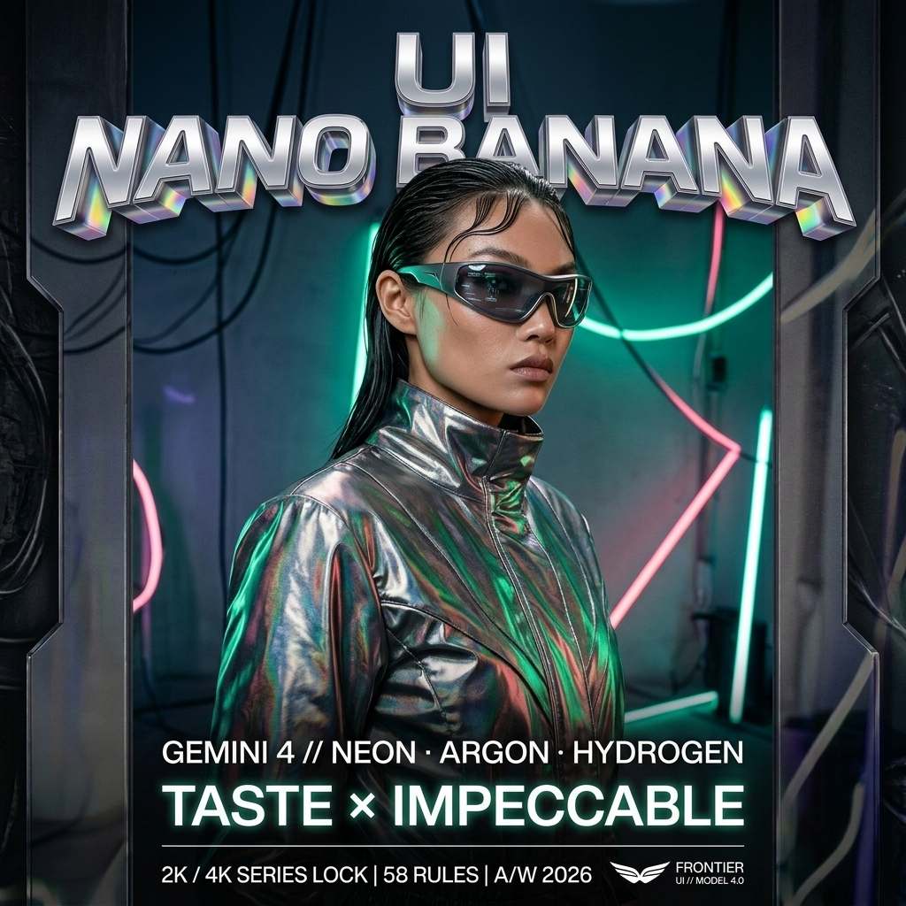

# ui-nanobanana — Anti-Slop Frontend & UI Design Skill with 4K Nano Banana & Gemini 4 for Claude Code, Cursor & Antigravity

*Read this in other languages: [English](README.md), [Español](README.es.md).*

[](LICENSE)
[](https://github.com/AntonioCardenas/ui-nanobanana/stargazers)
[](https://github.com/AntonioCardenas/ui-nanobanana/commits/main)
[](https://github.com/vercel-labs/skills)

> **Open-source AI frontend design, UX audit, and art-direction skill (`/ui`)** for **Claude Code**, **Cursor**, **Antigravity**, **Antigravity CLI**, **Codex**, and **OpenCode**. Eliminates generic "AI slop" UI templates by uniting **Taste Skill** gallery composition, **Impeccable** deterministic `DESIGN.md` guardrails (58 anti-slop rules & 21 `/ui` commands), and a **Hero-First Series-Locked 2K/4K visual pipeline** powered by **Nano Banana 2.1**, **Nano Banana Pro**, **Gemini Omni 1.2 Flash**, and **Gemini 4** (`Carbon`, `Argon`, `Neon`, `Hydrogen`).
>
> Need standalone media generation outside frontend builds? See the companion skill **[`generate-nanobanana`](https://github.com/AntonioCardenas/generate-nanobanana)**.

[](ui_nanobanana_showcase.png)
*Flagship cover generated with Nano Banana Pro &amp; Gemini 4 Neon: Y2K Solarpunk-Cyber couture portrait (`#0c1624` slate-navy studio, `#38d399` chlorophyll-emerald and `#f472b6` coral-pink neon reflections, `GEMINI 4 // NEON · ARGON · HYDROGEN`, `TASTE × IMPECCABLE`).*

---

## Why This Skill Exists

AI coding agents fail at frontend design in two predictable ways:

1. **Structural & CSS Slop:** Left alone, models output the statistical average of every template: centered three-line headlines, uppercase eyebrow badges (`"NEW · BETA"`), `Inter` over purple-to-blue glows (or the 2026 cream-and-terracotta cliché), three identical icon-in-a-square cards, and `01 / 02 / 03` numbering.
2. **The Visual Substance Vacuum:** Even when an anti-slop CSS skill removes the badges and gradients, a page with zero real imagery—or mismatched stock photos—reads as thin and empty. Empirical studies of 247 curated gallery sites and 91 Awwwards Sites of the Day prove that **top-scored pages carry 6–12 cohesive, art-directed visuals**, cover $\ge 50\%$ of the first viewport with flagship media on 68% of winners, and pair strict typographic math with interactive proof.

`ui-nanobanana` solves both halves in a single deterministic workflow:

- **Impeccable Deterministic Rails (`DESIGN.md` + `PRODUCT.md` + 58 Rules):** Compiles your brand palette, 5-step type system, surface mode (`Persuade`, `Operate`, `Read`, `Experience`), and explicit `anti_references` (e.g., Minimalist Solarpunk `#0c1624` dark base, zero pure `#ffffff`, no human hands/weapons) into deterministic files that every command obeys.
- **Taste Skill Art Direction Engine:** Enforces a **Subject Inventory** (8–12 specifics unique to the client), the **Competitor Test**, **One Live Thing** (a real interactive micro-instrument on the page), **Two-Line Headline Arithmetic** ($\le 32$ chars for `h1` across `1440px`, `768px`, and `390px`), and **Combinatorial Composition Variety** (no default left-text/right-image hero; no two neighboring sections sharing a layout).
- **OP High-Resolution Nano Banana Visual Pipeline:** Automatically syncs `DESIGN.md` into `generations/refs/brand/style.md`, presents **one upfront Batch Media Plan & Cost Quote** for the whole page, generates the **2K/4K Hero plate first** with engineered negative-space safe zones for UI typography, and locks all subsequent section plates (**Series Lock**), starting-frame **Gemini Omni 1.2 Flash** muted video loops (`3s`–`15s`), and **Gemini 4 Argon / Neon / Hydrogen** SVG/Three.js/GLSL shader code visuals to that Hero's exact lighting and color grade.

---

## Installation

Install directly from this repository using the [`skills` CLI](https://github.com/vercel-labs/skills):

```bash
npx skills add AntonioCardenas/ui-nanobanana
export GEMINI_API_KEY=your_key_here
```

Or clone directly into your agent's skills directory (naming the folder `ui` registers the `/ui` slash command):

```bash
git clone https://github.com/AntonioCardenas/ui-nanobanana ~/.claude/skills/ui
```

---

## The 10-Step Master Run (`/ui craft`)

1. **Context, Stack & Subject Inventory** — Reads `DESIGN.md` / `PRODUCT.md`, respects your stack (Angular v22 Zoneless + Signals, React/Next.js, Astro, GSAP, Lenis, Tailwind), and inventories 8–12 specifics unique to the subject.
2. **Argument & Two-Line Copy Arithmetic** — Structures sections as **Claims $\rightarrow$ Proof** and enforces $\le 2$ lines per headline at every viewport ($\le 32$ chars for Hero `h1`).
3. **Art Direction & Composition Matrix** — Locks Theme Paradigm, Hero Scale (`Giant Statement`, `Mid Editorial`, `Mini Minimalist`), and varied per-section Composition Anchors.
4. **The Idea, Competitor Test & "One Live Thing"** — Crafts the Idea Sentence and builds one functional interactive proof on the page.
5. **Upfront Batch Media Plan & Single Approval Gate** — Quotes the entire 2K/4K visual suite (Hero + Section Plates + Panoramic Dividers + optional Omni video loop + Argon SVGs/Shaders) in a single table and waits for your go-ahead.
6. **Sequential High-Res Generation with Series Lock** — Prepends `style.md` verbatim, generates the 2K/4K Hero first, passes the Hero into `reference_images` (or `previous_interaction_id`) for all section visuals, and writes `.json` sidecars.
7. **Still Interface & Token Build** — Builds CSS custom properties, equal outer frame margins, zero-CLS ``/`<video>` markup with tonal scrims, and themed browser surfaces (`::selection`, `:focus-visible`, `tabular-nums`).
8. **Purposeful Motion Layer** — Adds 1 signature move, staggered section entrances, tactile control feedback, and `prefers-reduced-motion` safety.
9. **58-Rule Deterministic Audit & Multi-Viewport Check** — Verifies `0 FAIL` across all 58 anti-slop rules at `1440px`, `768px`, and `390px`.
10. **Polish & Delivery Report** — Outputs the final audit score, Idea summary, and High-Res Media Manifest.

---

## Sub-Commands Vocabulary

| Command | Purpose |
|---|---|
| `/ui init` | Bootstrap `PRODUCT.md`, `DESIGN.md`, and `generations/refs/brand/style.md`. |
| `/ui document` | Extract existing project tokens and rules into `DESIGN.md` and `style.md`. |
| `/ui craft [target]` | Full 10-Step build with Batch Nano Banana 2K/4K Media Plan & Series Lock. |
| `/ui prompt [idea]` | Zero-cost Prompt Architect: outputs an optimized natural-language prompt + `WHY THESE CHOICES` rationale ($0.00 API cost). |
| `/ui visual-plan [target]` | Plan, quote, and generate a cohesive 2K/4K Nano Banana visual suite for an existing UI. |
| `/ui wireframe-to-comp <sketch>` | Convert a hand-drawn sketch, 2D floor plan, or wireframe into a 2K/4K visual comp / 3D render + frontend code. |
| `/ui localize-assets <lang>` | One-turn visual localization of in-image `"quoted"` text across languages while preserving layout & lighting. |
| `/ui edit-asset <file>` | Physics-aware delta edit (`previous_interaction_id`) or 2K/4K upscale from an asset's `.json` sidecar. |
| `/ui audit [target]` | Diagnostic check against all 58 anti-slop rules (`SLOP-01`–`SLOP-58`) without editing code. |
| `/ui critique [target]` | 14-pass Awwwards & UX heuristic score + top 3 highest-leverage improvements. |
| `/ui normalize [target]` | Align drifted colors, spacing, radii, and type sizes back to `DESIGN.md`. |
| `/ui polish [target]` | Eliminate all AI tells, theme browser surfaces, fix image attributes, and re-audit to 0 fails. |
| `/ui typeset` · `/ui colorize` · `/ui layout` · `/ui animate` | Targeted passes for typography math, color proportions, frame/anchor variety, and motion. |
| `/ui bolder` · `/ui quieter` · `/ui distill` · `/ui harden` · `/ui overdrive` | Scale visual ambition up/down, strip filler, harden states/a11y, or add Argon WebGL/GLSL shaders. |

---

## What's Inside

```text
SKILL.md                                    Master workflow, 4 Surface Modes, 10-Step Run, routing table
references/
  design-contract.md                        PRODUCT.md, DESIGN.md & style.md templates + Angular/React/GSAP patterns
  art-direction-and-copy.md                 Subject Inventory, Competitor Test, 2-Line Copy Math, Composition Matrix
  nanobanana-visual-pipeline.md             Batch Media Plan, Photographer's Briefs, Safe Zones, Series Lock, Omni Video
  prompt-engineering.md                     4 Golden Rules, 9-Dimension Discovery, 2D-to-3D, Localization & $0 Validator
  anti-slop-58-rules.md                     All 58 deterministic anti-slop rules (SLOP-01 to SLOP-58) & remediations
  commands-playbook.md                      Execution playbooks for all 18 /ui sub-commands
models/
  nano-banana-2-lite.md                     gemini-3.1-flash-lite-image (1K fast drafts)
  nano-banana-2.md                          gemini-nano-banana-2.1 (1K/2K/4K + panoramic 21:9, 4:1, 8:1)
  nano-banana-pro.md                        gemini-3-pro-image (2K/4K studio heroes + 14-reference fusion)
  gemini-omni-flash.md                      gemini-omni-1.2-flash (3s-15s 720p/1080p/4K video + starting-frame lock)
  gemini-4-hydrogen.md                      gemini-4-hydrogen (1M context fast daily driver for UI/SVG & ref analysis)
  gemini-4-neon.md                          gemini-4-neon (1M context fast frontier execution for UI/3D/SVGs)
  gemini-4-argon.md                         gemini-4-argon (1M context efficient frontier reasoning for SVGs, Three.js, shaders)
  gemini-4-carbon.md                        gemini-4-carbon (1M context maximum reasoning depth for complex 3D/GLSL shaders)
```

## Comparison: Why `ui-nanobanana` Beats CSS-Only UI Skills & Default AI Prompts

| Dimension | Default LLM Frontend | CSS-Only Anti-Slop Skill | `ui-nanobanana` (`/ui`) |
|---|---|---|---|
| **Layout & Typography** | Left-text/right-image hero, 3-card icon rows, purple gradients | Removes badges/gradients, but leaves thin/empty pages | **58 Anti-Slop Rules + 2-Line Headline Math (`<= 32` chars) + Varied Section Anchors** |
| **Visual Imagery** | Broken Unsplash URLs or mismatched stock | Public-domain archive search only | **2K/4K Nano Banana Studio Plates with Hero-First Series Lock & Negative-Space Safe Zones** |
| **Motion & 3D** | Identical fade-up on every block | Basic CSS transitions | **Starting-Frame-Locked Omni 1.2 Video Loops + Gemini 4 Three.js/GLSL Shaders** |
| **Interactive Proof** | Static marketing slogans | Static sections | **"One Live Thing" interactive domain instrument + `previous_interaction_id` state plates** |
| **Cost & Schema Safety** | Uncontrolled | No media API | **Single upfront Batch Media Quote + `$0` offline schema & MIME validator** |

## Frequently Asked Questions (FAQ)

### What is the best Claude Code or Cursor skill to stop "AI slop" in frontend UI design?
`ui-nanobanana` combines **58 deterministic anti-slop detection rules** (`/ui audit`, `/ui polish`) with `DESIGN.md` brand tokens, two-line headline character budgets, and cohesive **2K/4K Nano Banana 2.1 & Pro** studio photography so pages look art-directed rather than AI-generated.

### Does `ui-nanobanana` work with Angular, React, Next.js, Astro, and Tailwind CSS?
Yes. It is 100% framework-agnostic and respects your existing stack — including **Angular v22 Zoneless + Signals**, **React / Next.js Server Components**, **Astro**, **Vue**, **Svelte**, **Tailwind v4**, **GSAP**, and **Lenis**.

### How does Hero-First Series Lock keep website images visually consistent?
Instead of generating 6 unrelated images, `ui-nanobanana` compiles your `DESIGN.md` palette into `generations/refs/brand/style.md`, generates the **2K/4K Hero plate first** with a calm negative-space quadrant for UI headline legibility, and passes that approved Hero as a MIME-verified `input` image block into every subsequent section plate and **Gemini Omni 1.2 Flash** starting-frame video loop.

## Credits & Inspiration

- **[Leonxlnx/taste-skill](https://github.com/Leonxlnx/taste-skill)** & **[Leonxlnx/imagegen-skills](https://github.com/Leonxlnx/imagegen-skills)** by Leon (`@Leonxlnx`)
- **[pbakaus/impeccable](https://github.com/pbakaus/impeccable)** by Paul Bakaus & **[Dominando Impeccable: Skill de Diseño para IA](https://www.yeou.dev/articulos/dominando-impeccable-skill/)** by Antonio Cárdenas (`yeou.dev`)
- **[AntonioCardenas/generate-nanobanana](https://github.com/AntonioCardenas/generate-nanobanana)** by Antonio Cárdenas

## License

MIT

